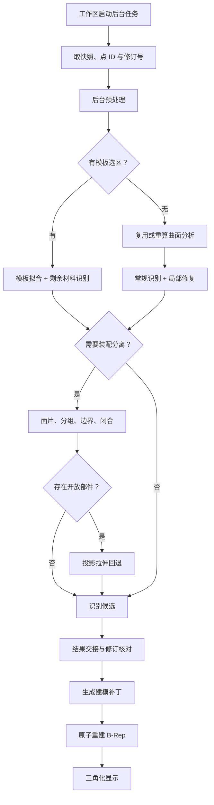

# 后台 CAD 重建流程

本文描述 ParamCAD Studio 中点击「重建 CAD」后，后台任务从点云快照到参数化模型提交的完整流程。

范围从工作区启动后台任务开始，到识别候选提交建模核心结束。图像拍摄、COLMAP 点云生成、点云编辑、PCAD 保存和 STEP 导出不在本文展开；这些环节见 [点云到 CAD 当前实现](Point_Cloud_to_CAD_Current_Implementation.md)。

## 1. 总览



核心原则：

- 后台线程只读输入快照、只计算候选，不访问模型文档、视口或工作区状态。
- 结果回到工作区线程后，先核对点云、模型和实体修订号，再决定是否提交。
- 识别结果只是建模提案，最终能否成为 B-Rep 由建模核心的原子补丁决定。

## 2. 入口与线程模型

### 2.1 客户端入口

主入口是 [PointCloudWorkspaceController::startCadReconstruction](../apps/ParamCAD%20Studio/src/app/PointCloudWorkspaceController.cpp#L557)：

| 入口 | 投影回退 | 说明 |
| --- | --- | --- |
| `工具 → 重建 CAD` | 开启 | 常规识别失败后允许装配和投影回退 |
| `工具 → 重建 CAD（不使用投影回退）` | 关闭 | 只做常规识别和装配闭合 |
| `调试 → 投影调试` | 单独入口 | 直接对单件点云运行投影拟合，见 `startProjection` |

启动前会检查：

- 点云是否已载入且工作点非空；
- 是否已有后台任务或分析线程在运行；
- 当前重建是否包含手动修改；若包含，先询问是否允许替换；
- 点云尺度是否已知；未知时要求用户明确确认 `1 源单位 = 1 mm`。

### 2.2 后台任务

[CadReconstructionTask](../apps/ParamCAD%20Studio/src/app/CadReconstructionTask.cpp#L175) 用独立 `QThread` 执行一次重建：

- `start()` 把点云、单位、模板、人工关系、共享分析、容差和回退开关打包成 `CadWork`；
- 工作线程调用 `runCadWork()`，通过 `stageChanged` 报告预处理、模板拟合、识别、分离和投影阶段；取消时由 `cancel()` 报告 `Cancelling`；
- `finished` 信号在任务对象所属线程发出，此时 `isRunning()` 仍为 `true`，保证结果处理期间不会被新任务插入；
- 取消使用原子标志，在阶段边界检查；已经进入的几何算法不会中途打断；
- 未知异常统一转为 `Failed`，异常文本进入 `result.error`。

工作线程的输入是值语义快照，输出是 `CadReconstructionResult`。模型提交、撤销历史和视口更新全部留在工作区线程。

## 3. 启动前快照与人工约束

### 3.1 点云与点 ID

工作区通过 `PointCloudDocument::workingCloud()` 取当前工作点云和对应的原始点 ID：

- 客户端 `PointId = 原文档行号 + 1`；
- 预处理删除点、跳过非有限坐标都不会给剩余点重新编号；
- 模板点会加入预处理保护列表，保证预处理后仍可按原 ID 找回。

### 3.2 模板与人工关系

- 只有 `templateLocked` 且有选区点的集合才会生成 `TemplateHint`；
- 模板类型映射为长方体、球、圆柱、圆锥、圆环或平面；
- 人工关系只收集非自动关系，转换为 `SurfaceRelationHint`，端点使用选区点 ID；
- 拟合距离容差从关系面板读取，传入后台后按 `appliedScaleToMillimeters` 换算到毫米。

### 3.3 修订号

启动时记录四个快照值：

- 点云修订号；
- 建模文档修订号；
- 视口实体修订号；
- 点云源文件路径。

后台计算期间任意一个发生变化，结果都会被丢弃，并提示重新重建。

### 3.4 单位与配置

- 米制输入在快照阶段统一转换为毫米；
- 未知尺度必须由用户确认，不能被静默当作毫米；
- 识别、装配、投影和局部恢复参数从 `config/*.conf` 读取；读取失败直接返回 `Failed`。

## 4. 后台主流程

后台主函数是 [runCadWork](../apps/ParamCAD%20Studio/src/app/CadReconstructionTask.cpp#L31)，执行顺序如下。

### 4.1 全量观测与预处理

1. 用 `PointCloudAdapter::toPointStore(cloud, unit)` 建立 `ObservationSnapshot`；
2. 记录跳过的非有限坐标数 `skippedInvalidObservations`；
3. 由 `PointCloudAdapter::preprocessingOptionsFor(cloud)` 生成预处理参数；
4. 把模板点加入 `protectedPointIds`；
5. 调用 `preprocessPointCloud(source, options, points, report, error)`。

预处理包括：

- 体素降采样，体素尺寸由稳健包围尺度决定；
- 统计离群过滤，阈值使用中位数/MAD 抑制远处噪点；
- 缺失法向的 PCA 估计、曲率估计和方向传播；
- 方向未确定的点保留，但常规识别会拒绝在方向未知时自动建体。

失败返回 `PreprocessingFailed`，模型和点云都不改变。

### 4.2 分支选择

预处理成功后：

```text
hints.empty() ? Conventional : Guided
```

无论哪条分支，都统一调用 [reconstructGuidedSolid](../core/geometric_reconstruction/src/recognition/guided/GuidedSolidRecognizer.cpp#L168)。区别在于是否传入模板。

同时生成平面和圆柱检测参数：

- `PointCloudAdapter::planeOptionsFor(points)`；
- `PointCloudAdapter::cylinderOptionsFor(points)`；
- 若启动时提供了 `sourceTolerance > 0`，平面和圆柱的距离阈值都改为 `sourceTolerance × appliedScaleToMillimeters`。

### 4.3 模板引导分支（Guided）

1. 对每个模板选区单独拟合，得到模板拟合结果和种子证据；
2. 已完整观测的曲面部件先固定，并从剩余材料中扣除；
3. 对剩余材料重新做曲面分析，再走常规识别；
4. 将模板拟合结果和自动识别结果合并；
5. 用 `verifyHints` 复验模板约束；覆盖率不足时整轮失败，并返回失败的选区 ID；
6. 如果存在人工关系，重新对全量观测做分析并应用关系，保证关系端点仍指向原始快照。

模板结果中会保留 `TemplateFit`，用于界面回填模板拟合信息。

### 4.4 常规识别分支（Conventional）

#### 分析复用

没有模板时，先尝试复用工作区缓存的表面分析：

- 点云指纹一致；
- 单位、检测设置和选项一致。

满足时直接使用 `sharedAnalysis`，并标记 `analysisReused = true`；否则调用 `analyzeSurfaces` 重新做多轮/多尺度 CGAL Efficient RANSAC 检测。

#### 识别与修复

随后进入 [recognizeAndRepairParametricSolid](../core/geometric_reconstruction/src/recognition/RepairTransaction.cpp#L82)：

1. 把分析快照物化为观测点；
2. 建立临时分析副本，并应用人工关系；
3. 先做一次基线识别；
4. 如果存在“可修复”的局部失败区域：
   - 收集局部修复证据；
   - 合并观测与证据，重建面片索引；
   - 用原始点 ID 重新绑定人工关系；
   - 重新识别并复验覆盖率；
   - 修复不通过时拒绝合并，保留原分析和基线候选。

#### 识别顺序

常规识别在 [recognizeParametricSolidFromAnalysis](../core/geometric_reconstruction/src/recognition/ParametricSolidRecognizer.cpp#L31) 中按以下顺序选择候选：

1. **混合特征**：宿主 + 通孔 + 附着体/切除棱柱；
2. 如果混合结果包含曲面实体、通孔或切除，直接采用；
3. **组合体**：长方体、棱柱和材料单元；
4. 组合体覆盖不足时回退到混合结果；
5. **单箱体 + 贯穿孔**；
6. **独立曲面实体**：球、圆柱、圆锥/圆台、圆环体。

单箱体路径还会检查边界覆盖；覆盖不足 `0.80` 时转入独立曲面识别。

## 5. 装配回退

### 5.1 触发条件

装配只在同时满足以下条件时尝试：

```text
hints.empty()
&& relations.empty()
&& (!recognized || bodies > 1 || refineBox)
```

其中：

- `bodies = boxes + prisms + curvedSolids`；
- `refineBox = recognized && bodies == 1 && boxes == 1 && surfaceCoverage < 0.99`。

也就是说，有模板或有人工关系时，显式约束优先，不做自动装配分解。

### 5.2 执行顺序

装配入口是 [reconstructAssembly](../core/geometric_reconstruction/src/recognition/assembly/AssemblyReconstruction.cpp#L294)，顺序固定为：

1. `extractPatches`：从全量观测提取装配面片；
2. `groupPatches`：按邻接、法向和间距把面片分组成部件；
3. `recoverBoundaries`：恢复面片的有限边界轮廓，可有孔或分离岛；
4. `assignSourceObservations`：把全量观测点回填到部件；
5. `closeParts`：共边、壳闭合和试建；
6. 专用局部恢复：
   - `closeAnalyticProfile`：解析轮廓体；
   - `closeAnnularTube`：环形管；
   - `closeCircularSlab`：圆盘体；
   - `recoverLocalProfiles`：局部轮廓恢复；
7. `fitOpenParts`：对仍未闭合且有足够观测的部件做投影拉伸拟合。

默认参数来自 [assembly.conf](../apps/ParamCAD%20Studio/config/assembly.conf)：

| 参数 | 默认值 | 作用 |
| --- | --- | --- |
| `maximum_working_points` | 200000 | 装配采样上限 |
| `neighbors` | 32 | 邻域数量 |
| `minimum_patch_points` | 24 | 面片最低点数 |
| `build_solids` | true | 是否试建实体 |
| `enable_specialized_recovery` | true | 启用专用局部恢复 |
| `maximum_projection_parts` | 6 | 开放部件投影回退上限，0 为关闭 |
| `minimum_projection_part_points` | 60 | 参与投影回退的最低点数 |

如果关闭投影回退，或当前只是 `refineBox`，工作区会把 `maximumProjectionParts` 置为 0，避免在轮廓精修场景中额外生成投影体。

### 5.3 结果处理

装配结果按以下方式进入最终结果：

| 装配结果 | 分支 | 结果 |
| --- | --- | --- |
| 有解析轮廓体、曲面体或投影程序 | `Assembly` | 成功，提交装配候选 |
| 建立了分组但没有闭合 CAD | `Assembly` | `Unsupported`，分组、边界和部件候选仍显示在点云中 |
| `refineBox` 且装配没有得到轮廓精修 | 保留常规结果 | 丢弃装配结果，继续使用常规候选 |
| 装配调用失败 | 保留常规结果 | 若常规已有成功候选，仍可交接 |
| 装配部分成功 | `Assembly` | `partialAssembly = true`，提交通过验证的实体，同时保留开放部件 |

## 6. 投影回退

投影回退有两个入口：

- 装配流程中的 `fitOpenParts`，只处理开放部件；
- 调试入口 `startProjection`，可直接对单件点云运行。

投影阶段包括：

1. 生成候选拉伸轴；
2. 沿轴求区间、端面和截面观测；
3. 恢复二维截面，表达外轮廓和有证据的孔；
4. 生成基体、台阶、直槽切除、盲孔切除等操作提案；
5. 临时试建并评分：体积、距离分位、内点率、法向误差、无支持面比例；
6. 搜索操作序列，只在通过时发布操作序列。

未通过时保留 `rejectedOperations` 和质量诊断，供投影调试页显示。投影调试页可以把通过的结果作为 `CompoundCandidate::projectionPrograms` 应用到 CAD。

## 7. 结果对象

后台返回的 [CadReconstructionResult](../apps/ParamCAD%20Studio/src/app/CadReconstructionTask.h#L30) 包含：

| 字段 | 含义 |
| --- | --- |
| `outcome` | `Success`、`PreprocessingFailed`、`Unsupported`、`Failed`、`Cancelled` |
| `branch` | `None`、`Conventional`、`Guided`、`Assembly` |
| `partialAssembly` | 装配是否部分成功 |
| `preprocessingComplete` | 预处理是否完成 |
| `preprocessing` | 点数变化、移除数、法向统计 |
| `candidate` | 识别出的 `CompoundCandidate` |
| `analysis` | 本轮使用的 `SurfaceAnalysisResult` |
| `analysisReused` | 是否复用了缓存分析 |
| `templateFits` | 模板拟合结果 |
| `failedRegionId` | 模板失败时对应的选区 |
| `error` | 失败原因 |
| `assembly` | 装配中间结果，包含部件、面片、边界和未分配点 |
| `projectionDebug` | 投影调试结果 |
| `skippedInvalidObservations` | 跳过的非有限坐标数 |

`CompoundCandidate` 可包含：

- `boxes`：长方体；
- `prisms`：多边形棱柱；
- `throughHoles`：贯穿孔；
- `curvedSolids`：球、圆柱、圆锥/圆台、圆环；
- `profileBodies`：有限边界壳体；
- `projectionPrograms`：投影拉伸操作序列；
- `surfaceCoverage`、`confidence` 和诊断信息。

## 8. 结果交接

结果回到工作区线程后进入 [onCadReconstructionFinished](../apps/ParamCAD%20Studio/src/app/PointCloudWorkspaceController.cpp#L836)。

处理顺序：

1. 如果是投影调试结果，转到投影调试页，不修改 CAD；
2. 若分析带点云指纹，缓存为下一次可复用的表面分析；
3. 核对点云、模型和实体修订号；任一变化则丢弃结果；
4. 取消：提示模型保持原状；
5. 预处理完成：把点数、降采样、离群过滤和法向统计写入日志；
6. 有装配结果：把部件候选写回点云集合，更新装配边界，记录闭合/开放数量；
7. `Unsupported`：提示失败原因；如果有装配结果，说明分离结果已显示在点云中；
8. `PreprocessingFailed` / `Failed`：提示错误，模型保持原状；
9. `Success`：提交 `CompoundCandidate`；
10. 模板拟合成功时，回填模板拟合信息并重新推断关系；
11. 输出最终实体统计和状态栏文本；
12. 成功且不是装配结果时，若全量选区点数足够，再自动触发一次表面分析。

## 9. 建模提交

成功候选通过 [ModelingController::commitReconstructedCompound](../apps/ParamCAD%20Studio/src/app/ModelingController.cpp#L134) 提交：

1. 保存当前建模文档作为撤销快照；
2. 调用 [commitCompoundCandidate](../core/geometric_reconstruction/src/modeling/ModelingAdapter.cpp#L95)；
3. [planCompoundCandidate](../core/geometric_reconstruction/src/modeling/ModelingAdapter.cpp#L5) 把候选转换成绑定当前修订的 `ModelPatch`：
   - 分配草图和依赖 ID；
   - 生成有序建模命令；
   - 记录预期修订；
   - 记录投影布尔目标体；
4. [ModelingCore::apply](../core/parametric_modeling/src/ModelingCore.cpp#L65) 原子应用：
   - 校验草图参数和闭合性；
   - OCCT 构面；
   - 按特征历史重建 B-Rep；
   - 任一命令或重建失败则整体回滚；
5. 成功：记录撤销历史，发出 `modelRebuilt`，工作区重新三角化并更新显示；
6. 失败：返回 `lastError`，界面弹窗提示，模型保持原状。

## 10. 失败、取消与降级

| 场景 | `outcome` | 模型状态 | 点云/界面状态 |
| --- | --- | --- | --- |
| 预处理失败 | `PreprocessingFailed` | 不变 | 日志记录错误 |
| 常规识别失败 | `Unsupported` | 不变 | 可显示失败选区 |
| 装配只有开放部件 | `Unsupported` | 不变 | 显示部件分组和边界 |
| 装配部分成功 | `Success` | 提交闭合部分 | 保留开放部件 |
| 投影拟合拒绝 | 对应分支失败或 `Unsupported` | 不变 | 调试页保留拒绝诊断 |
| 建模补丁失败 | `Success` 但提交失败 | 回滚 | 弹窗显示建模错误 |
| 计算期间点云/模型被修改 | 结果丢弃 | 不变 | 提示重新重建 |
| 用户取消 | `Cancelled` | 不变 | 在阶段边界停止 |
| 未捕获异常 | `Failed` | 不变 | 记录异常文本 |

## 11. 关键配置与容差

| 配置 | 作用 |
| --- | --- |
| `config/preprocessing.conf` | 体素、离群过滤、法向估计 |
| `config/detection.conf` | CGAL 基元检测、距离阈值、随机种子 |
| `config/analysis.conf` | 多轮/多尺度分析、面片连通、关系容差 |
| `config/recognition.conf` | 混合、组合体、箱体、通孔、曲面识别 |
| `config/assembly.conf` | 装配采样、分组、闭合、局部恢复、投影回退 |
| `config/projection.conf` | 投影轴、截面、提案、评分和搜索预算 |

注意：

- `.conf` 距离参数默认使用毫米；
- 用户输入的点云容差会先乘以 `appliedScaleToMillimeters`；
- 装配距离容差为 0 时，由装配流程从观测中自行估计局部噪声；
- 识别参数在后台任务开始时读取一次，计算过程中不会热更新。

## 12. 代码索引

| 环节 | 源码 |
| --- | --- |
| 工作区启动与快照 | [PointCloudWorkspaceController.cpp](../apps/ParamCAD%20Studio/src/app/PointCloudWorkspaceController.cpp#L557) |
| 后台任务与主流程 | [CadReconstructionTask.cpp](../apps/ParamCAD%20Studio/src/app/CadReconstructionTask.cpp#L31) |
| 模板/常规统一入口 | [GuidedSolidRecognizer.cpp](../core/geometric_reconstruction/src/recognition/guided/GuidedSolidRecognizer.cpp#L168) |
| 常规识别顺序 | [ParametricSolidRecognizer.cpp](../core/geometric_reconstruction/src/recognition/ParametricSolidRecognizer.cpp#L31) |
| 局部修复事务 | [RepairTransaction.cpp](../core/geometric_reconstruction/src/recognition/RepairTransaction.cpp#L82) |
| 装配分解 | [AssemblyReconstruction.cpp](../core/geometric_reconstruction/src/recognition/assembly/AssemblyReconstruction.cpp#L294) |
| 投影拟合 | [ProjectionExtrusion.cpp](../core/geometric_reconstruction/src/recognition/projection/ProjectionExtrusion.cpp#L359) |
| 结果交接 | [PointCloudWorkspaceController.cpp](../apps/ParamCAD%20Studio/src/app/PointCloudWorkspaceController.cpp#L836) |
| 建模计划 | [ModelingAdapter.cpp](../core/geometric_reconstruction/src/modeling/ModelingAdapter.cpp#L5) |
| 原子重建 | [ModelingCore.cpp](../core/parametric_modeling/src/ModelingCore.cpp#L65) |

## 13. 当前边界

- 自动识别覆盖组合长方体、平面加强筋、单长方体贯穿孔、独立球/圆柱/圆锥/圆环体、部分装配和投影拉伸。
- 缺面、遮挡、多零件自动分割、通用拓扑命名和任意机械零件仍不是通用能力。
- 实拍贯穿孔样本在当前版本仍可能漏检。
- 后台取消只在阶段边界生效；已经进入的 CGAL、OCCT 或装配计算不会被强制中断。
- 识别结果必须经过建模核心重建才能成为 B-Rep；识别成功不等于建模一定成功。
