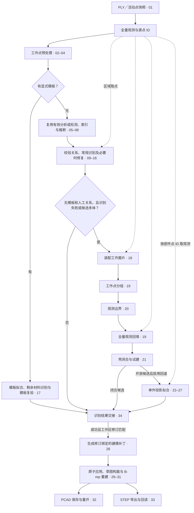

# 点云到 CAD 当前实现审阅

本文记录当前工作树中从 PLY 或活动点云进入 CAD 重建，到特征提交、PCAD 保存重开和 STEP 导出的实际流程。编号沿用[模块契约与重构计划](Point_Cloud_to_CAD_Module_Contracts_and_Refactoring_Plan.md)。表中的输入输出按当前代码填写。标记为「内部」的入口由组合函数调用，也可由仓库内的阶段测试直接调用。

相机采集和点云生成位于本文范围之前。用户选区、任务取消和结果交接列入流程，视口绘制只在影响结果交接时说明。

## 1. 生产流程

1. **快照与尺度。** 客户端提取活动点，保留原文档行映射，并将已知米制坐标转换到毫米。单位不明时，客户端先请用户确认按毫米解释。模板点 ID 传入预处理保护列表。同一坐标系中，全量快照供装配与局部恢复使用，常规识别读预处理后的工作点。[工作区启动](<../apps/ParamCAD Studio/src/app/PointCloudWorkspaceController.cpp#L415>) · [同步任务主体](<../apps/ParamCAD Studio/src/app/CadReconstructionTask.cpp#L24>)
2. **识别选择。** 有模板时先拟合选区，再识别剩余材料并复验模板。无模板时，普通路径复用指纹和配置匹配的分析，或重新分析，再校验人工关系与识别结果。常规识别先尝试混合特征，按诊断和覆盖情况进入组合体、已有混合候选、箱体加通孔或独立曲面路径。[模板／常规入口](../core/geometric_reconstruction/src/recognition/guided/GuidedSolidRecognizer.cpp#L160) · [常规候选选择](../core/geometric_reconstruction/src/recognition/ParametricSolidRecognizer.cpp#L30)
3. **装配回退。** 没有模板及人工关系时，常规识别失败或候选箱体、棱柱、曲面实体数合计大于一，才尝试装配。装配若建立分组但没有通过的 CAD 候选，任务保留开放候选并返回 `Unsupported`。装配调用本身失败时，已有成功的常规候选仍可交接。启用投影回退时，生产任务最多试拟合 6 个满足点数和面片门槛的开放部件。[分支条件](<../apps/ParamCAD Studio/src/app/CadReconstructionTask.cpp#L62>) · [开放部件投影](../core/geometric_reconstruction/src/recognition/assembly/AssemblyReconstruction.cpp#L20) · [装配调用顺序](../core/geometric_reconstruction/src/recognition/assembly/AssemblyReconstruction.cpp#L239)
4. **交接与持久化。** 任务在后台计算，工作区在拥有线程接收结果，核对点云、模型和视口实体修订后提交候选。部分装配可提交通过验证的实体，同时保留开放部件和诊断。PCAD 保存、STEP 导出由客户端或验证入口调用。`reconstruct-cloud` 复用生产任务，`fit-projection` 直接从单件 PLY 进入投影拟合。[工作区交接](<../apps/ParamCAD Studio/src/app/PointCloudWorkspaceController.cpp#L566>) · [生产流程验证](../tools/validation/native/PointCloudCadValidation.cpp#L34) · [投影独立入口](../tools/validation/native/PointCloudCadValidation.cpp#L113)

## 2. 跨阶段数据口径

| 数据 | 当前口径 |
| --- | --- |
| `ObservationSnapshot`、`PointStore` | 快照保存仅做统一尺度转换的全量观测，提供源单位、比例和观测指纹。客户端 `PointId` 是原文档行号加一，活动点删减和跳过非有限坐标都不会给剩余点重新编号。`PointStore` 要求 ID 非零且唯一。[快照类型](../core/geometric_reconstruction/include/reconstruction/data/PointStore.h#L60) · [导入映射](<../apps/ParamCAD Studio/src/io/PointCloudAdapter.cpp#L95>) |
| `PrimitiveEvidence`、`SurfaceAnalysisResult` | 基元记录方程和支持点，`SurfacePatch` 记录一个基元的有限连通支持，关系端点引用分析面片。基元 ID 和面片 ID 由索引重建，适用范围是本分析快照。合并修复另记基线及源指纹、补点、局部到全局映射。[证据类型](../core/geometric_reconstruction/include/reconstruction/data/PrimitiveEvidence.h#L10) · [分析快照](../core/geometric_reconstruction/include/reconstruction/analysis/SurfaceAnalysis.h#L73) |
| `AssemblyReconstructionResult` | 装配面片和部件 ID 属于本次分解。`workingPointIds` 指装配采样归属，`pointIds` 指全量回填归属，两者独立。若闭合替换轮廓，`boundaryBeforeClosure` 保留观测轮廓，`loops` 为闭合处理后的版本。装配覆盖率统计闭合候选所属观测比例。[装配数据类型](../core/geometric_reconstruction/include/reconstruction/recognition/AssemblyReconstruction.h#L36) · [装配结果](../core/geometric_reconstruction/include/reconstruction/recognition/AssemblyReconstruction.h#L73) |
| 投影拟合点与评分点 | 对单件观测做有界拟合采样，再生成固定评分视图。候选共享评分视图，残差 ID 来自该视图。可用 `ProjectionExtrusionResult` 查轴来源、试拟合状态、操作序列和质量。[评分视图](../core/geometric_reconstruction/src/recognition/ProjectionExtrusion.cpp#L157) · [投影结果](../core/geometric_reconstruction/include/reconstruction/recognition/ProjectionExtrusion.h#L49) |
| `CompoundCandidate`、`ModelPatch` | 识别输出仍是建模提案。计划生成时分配草图和依赖 ID，把有序命令绑定到当前模型修订。应用后由建模核心返回受影响的特征 ID。[CAD 候选](../core/geometric_reconstruction/include/reconstruction/recognition/CompoundRecognizer.h#L27) · [建模补丁](../core/parametric_modeling/include/modeling/ModelPatch.h#L18) |

## 3. 模块输入、输出与源码

### A. 点云输入和预处理

| 编号与模块 | 输入 | 输出 | 源码入口 |
| --- | --- | --- | --- |
| 01 点云读取、活动点快照与单位转换 | PLY 或内存 `PlyCloud`、活动点及源行映射、单位声明 | 有效全量 `ObservationSnapshot`、源单位与尺度、稳定 `PointId` 和指纹。读取错误由 PLY 适配层返回，任务记录跳过的非有限坐标数。 | [PLY 读取](<../apps/ParamCAD Studio/src/io/PlyReader.cpp#L539>) · [活动点快照](<../apps/ParamCAD Studio/src/core/PointCloudEdits.cpp#L197>) · [导入映射](<../apps/ParamCAD Studio/src/io/PointCloudAdapter.cpp#L95>) · [统一尺度](../core/geometric_reconstruction/src/data/PointStore.cpp#L97) |
| 02 体素降采样（内部） | 统一坐标的点样本、体素尺寸、保护点 ID | 原始样本中的体素代表和受保护点，保留各自 ID。组合预处理报告降采样前后点数。 | [voxelDownsample](../core/geometric_reconstruction/src/preprocessing/Downsampling.cpp#L30) · [预处理组合](../core/geometric_reconstruction/src/preprocessing/PointCloudPreprocessor.cpp#L48) |
| 03 离群过滤（内部） | 工作样本、邻域与统计阈值配置、保护点 ID | 保留样本及其 ID，更新移除数、平均与中位邻距、实际阈值。移除 ID 可由输入和保留集求差。 | [removeOutliers](../core/geometric_reconstruction/src/preprocessing/OutlierFilter.cpp#L4) |
| 04 法向、定向和曲率（内部） | 点样本、已有法向及定向状态、邻域和传播参数 | 更新同 ID 样本的法向、方向可信状态及可选曲率，报告估计、定向及退化数量。 | [estimateNormalsAndCurvature](../core/geometric_reconstruction/src/preprocessing/NormalEstimation.cpp#L4) |

### B. 曲面分析与修复

| 编号与模块 | 输入 | 输出 | 源码入口 |
| --- | --- | --- | --- |
| 05 单次基元检测 | `PointStore`、启用基元族、距离与支持阈值、随机种子 | `PrimitiveDetectionResult`，含平面、圆柱、球、圆锥、圆环候选的参数、支持点、拟合信息及未分配点。 | [检测入口](../core/geometric_reconstruction/src/detection/PrimitiveDetector.cpp#L7) · [CGAL 后端](../core/geometric_reconstruction/src/detection/cgal/CgalEfficientRansacDetector.cpp#L6) |
| 06 多轮检测和证据汇集 | 工作点、检测设置、分族或多尺度策略、可选手工种子与取消回调 | `SurfaceEvidenceCollection`，含合并证据、未分配点及检测轮数。 | [collectSurfaceEvidence](../core/geometric_reconstruction/src/analysis/SurfaceAnalysis.cpp#L7) · [多尺度检测](../core/geometric_reconstruction/src/detection/MultiScaleDetector.cpp#L10) |
| 07 证据索引和有限面片 | 同一快照中的点、基元及支持 ID、连通配置 | `SurfaceAnalysisResult` 中的重编号基元、连通面片、质心、范围、方向和未分配点。`indexSurfacePatches` 返回后可单独推断关系。 | [面片索引](../core/geometric_reconstruction/src/analysis/SurfacePatches.cpp#L50) · [索引与推断组合入口](../core/geometric_reconstruction/src/analysis/SurfacePatches.cpp#L130) |
| 08 关系推断与人工关系校验 | 已索引面片或 `RelationSurface`、局部观测、关系容差、可选按点 ID 描述的人工关系 | 含误差、置信度和自动来源标记的关系集。手工校验返回是否接受及错误信息。 | [从面片推断](../core/geometric_reconstruction/src/analysis/SurfacePatches.cpp#L120) · [关系计算](../core/geometric_reconstruction/src/analysis/SurfaceRelations.cpp#L32) · [人工校验](../core/geometric_reconstruction/src/analysis/SurfaceRelations.cpp#L122) |
| 09 关系优化 | 同一快照的分析、观测点、候选关系和配置 | 更新可接受的基元参数，给出接受／拒绝关系和前后误差。 | [optimizeSurfaceRelations](../core/geometric_reconstruction/src/analysis/RelationOptimization.cpp#L32) |
| 10 局部观测恢复 | 工作快照、同单位同坐标的源快照、分析、失败区域 ID、可选搜索范围 | `LocalObservationRecovery` 提供局部点、补点 ID、源指纹及搜索范围。组合恢复再给出局部证据、面片、关系与诊断。 | [独立取点](../core/geometric_reconstruction/src/analysis/LocalRecovery.cpp#L14) · [恢复与局部重检](../core/geometric_reconstruction/src/analysis/LocalRecovery.cpp#L89) |
| 11 修复合并与复验 | 原分析和观测、初次候选、局部修复提案、人工关系 | 合并观测及映射、复验前后覆盖率。通过时发布新分析和候选。失败时报告原因，保留原分析。 | [合并证据](../core/geometric_reconstruction/src/recognition/RepairTransaction.cpp#L45) · [复验约束](../core/geometric_reconstruction/src/recognition/RepairTransaction.cpp#L61) · [修复事务](../core/geometric_reconstruction/src/recognition/RepairTransaction.cpp#L82) · [修复快照物化](../core/geometric_reconstruction/src/analysis/RepairSnapshot.cpp#L6) |

### C. 常规实体识别和人工引导

| 编号与模块 | 输入 | 输出 | 源码入口 |
| --- | --- | --- | --- |
| 12 箱体识别 | 工作点、平面证据或分析快照、配对和容差配置 | `BoxCandidate`，含姿态、三维尺寸、源平面和置信度。轴对齐场景另有直接入口。 | [基于共享分析](../core/geometric_reconstruction/src/recognition/BoxRecognizer.cpp#L220) · [基于平面](../core/geometric_reconstruction/src/recognition/BoxRecognizer.cpp#L77) · [轴对齐箱体](../core/geometric_reconstruction/src/recognition/AxisAlignedBoxRecognizer.cpp#L24) |
| 13 贯穿孔识别 | 已识别宿主箱体、圆柱壁证据、孔识别配置 | `ThroughHoleCandidate`，含孔轴、半径、源圆柱、穿越宿主的厚度和置信度。 | [孔识别](../core/geometric_reconstruction/src/recognition/ThroughHoleRecognizer.cpp#L51) · [箱体与孔组合入口](../core/geometric_reconstruction/src/recognition/ThroughHoleRecognizer.cpp#L198) |
| 14 独立曲面实体识别 | 部件点、分析证据、容差、可选种子与基元类别 | 有限球、圆柱、圆锥或圆环候选，带表面与边界覆盖、残差或拒绝原因。 | [独立曲面实体](../core/geometric_reconstruction/src/recognition/curved/CurvedSolidRecognizer.cpp#L42) · [端面检测](../core/geometric_reconstruction/src/recognition/curved/CapDetection.cpp#L4) · [边界评估](../core/geometric_reconstruction/src/recognition/curved/BoundaryAssessment.cpp#L55) |
| 15 组合体识别 | 定标点云和有向法向、可选边界／接口平面、搜索预算 | 箱体和棱柱候选、覆盖率、材料单元数与搜索信息，含箱体最小覆盖是否得到证明。 | [组合体入口](../core/geometric_reconstruction/src/recognition/compound/CompoundRecognizer.cpp#L5) · [材料单元](../core/geometric_reconstruction/src/recognition/compound/MaterialCells.cpp#L4) · [箱体覆盖](../core/geometric_reconstruction/src/recognition/compound/BoxCover.cpp#L4) |
| 16 混合特征识别 | 工作点、同快照分析、可选全量源点。局部入口另接收宿主坐标系和区域证据。 | 宿主、通孔、附着体或切除棱柱，附失败区域及可用修复提案。 | [混合识别](../core/geometric_reconstruction/src/recognition/mixed/MixedFeatureRecognizer.cpp#L30) · [局部特征](../core/geometric_reconstruction/src/recognition/mixed/MixedFeatureRecognizer.cpp#L7) · [宿主识别](../core/geometric_reconstruction/src/recognition/mixed/HostDetection.cpp#L4) |
| 17 模板和人工关系引导 | 点云、模板类型及选区点 ID、检测配置、可选分析／人工关系／全量源 | 独立模板阶段输出选区拟合、种子、调整后的工作样本和已闭合曲面候选。组合入口输出全局候选、分析、各模板结果和失败选区。 | [选区拟合](../core/geometric_reconstruction/src/recognition/guided/GuidedSolidRecognizer.cpp#L10) · [整体引导](../core/geometric_reconstruction/src/recognition/guided/GuidedSolidRecognizer.cpp#L160) · [模板复验](../core/geometric_reconstruction/src/recognition/guided/HintValidation.cpp#L36) |

### D. 装配面片、分组、边界和闭合

执行顺序为 **18 → 19 分组 → 20 → 19 回填 → 21**。模块 20 读取装配工作样本，回填发生在边界恢复之后。[组合入口](../core/geometric_reconstruction/src/recognition/assembly/AssemblyReconstruction.cpp#L239)

| 编号与模块 | 输入 | 输出 | 源码入口 |
| --- | --- | --- | --- |
| 18 装配面片提取（内部） | 毫米制全量观测、工作采样预算、邻域和连通配置 | `PatchExtraction`，含内部工作集、面片方位、范围、平面性、局部间距、残差、支持点和未分配工作 ID。 | [extractPatches](../core/geometric_reconstruction/src/recognition/assembly/AssemblyReconstruction.cpp#L79) · [阶段类型](../core/geometric_reconstruction/src/recognition/assembly/AssemblyInternal.h#L17) |
| 19 连接、分组和全量回填（内部） | 分组读工作集与面片，回填另读源快照及分组映射 | `PatchGrouping`、面片连接证据、部件的工作点和全量点归属、未分配全量点。 | [groupPatches](../core/geometric_reconstruction/src/recognition/assembly/AssemblyReconstruction.cpp#L187) · [assignSourceObservations](../core/geometric_reconstruction/src/recognition/assembly/AssemblyReconstruction.cpp#L220) |
| 20 有限边界恢复（内部） | 面片工作支持点、局部平面、间距、容差、已接受的邻接约束 | 世界坐标的有限轮廓环，可能有孔或分离岛，并带有吸附、简化及拓扑回退统计。 | [面片边界恢复](../core/geometric_reconstruction/src/recognition/assembly/FiniteBoundaries.cpp#L51) · [二维轮廓](../core/geometric_reconstruction/src/recognition/assembly/FiniteBoundaries.cpp#L19) · [拓扑对照](../core/geometric_reconstruction/src/recognition/assembly/BoundaryGeometry.cpp#L182) |
| 21 共边、壳闭合和试建（内部） | 工作观测、面片及边界、部件分组与回填计数、构造选项 | 各部件壳状态、开边和非流形计数，必要时记录轮廓修订前版本及来源。通过验证的有限边界体或解析曲面体进入候选。 | [closeParts](../core/geometric_reconstruction/src/recognition/assembly/PartClosure.cpp#L92) · [凸支撑平面修订](../core/geometric_reconstruction/src/recognition/assembly/PartClosure.cpp#L15) |

### E. 投影拉伸拟合

生产由开放装配部件进入，验证命令也可以直接给单件。阶段接口集中在 `ProjectionInternal.h`，对外由 `fitProjectionExtrusion` 组合调用。[投影阶段接口](../core/geometric_reconstruction/src/recognition/ProjectionInternal.h#L21) · [投影组合入口](../core/geometric_reconstruction/src/recognition/ProjectionExtrusion.cpp#L309)

| 编号与模块 | 输入 | 输出 | 源码入口 |
| --- | --- | --- | --- |
| 22 候选轴生成（内部） | 拟合点、用于法向方向估计的观测、基元证据、中心、方向策略及预算 | `ProjectionAxisReport` 列表，记录候选轴和来源。投影面积及包络体积由区间计算补齐。 | [generateAxes](../core/geometric_reconstruction/src/recognition/ProjectionExtrusion.cpp#L206) |
| 23 拉伸区间和截面观测（内部） | 拟合点、给定轴的局部坐标系、距离容差 | `Interval`，含轴向起止、凸投影面积和可选两端 `Cap`。`Cap` 包含截面深度与支持样本，缺支持时为空。 | [inspectInterval](../core/geometric_reconstruction/src/recognition/ProjectionExtrusion.cpp#L191) · [capAt](../core/geometric_reconstruction/src/recognition/ProjectionExtrusion.cpp#L173) |
| 24 二维截面恢复（内部） | 指定截面和坐标系、端面范围、部件点、可用侧壁和孔壁证据 | 线段或圆等草图实体，表达外轮廓和有证据的孔。候选操作另行保留截面支持点 ID。 | [recoverProfile](../core/geometric_reconstruction/src/recognition/ProjectionProfile.cpp#L81) |
| 25 基体、加材与切除提案（内部） | 已知截面、区间及中间面证据，或盲孔壁和开口观测 | `AxisProposal` 或 `ProjectionOperation`，含草图、深度、方向、操作类型及支持点。通过单体试建的台阶提案可进入加材搜索。 | [基体和台阶](../core/geometric_reconstruction/src/recognition/ProjectionProposals.cpp#L108) · [直槽切除](../core/geometric_reconstruction/src/recognition/ProjectionProposals.cpp#L11) · [盲孔切除](../core/geometric_reconstruction/src/recognition/ProjectionProposals.cpp#L59) |
| 26 候选实体评分（内部） | 已试建 B-rep、固定评分样本、距离容差、操作和曲线数量、可选取消回调 | `Fit`，含体积、距离分位数、内点率、法向误差、无支持面面积比例、残差 ID 与总分。 | [scoreShape](../core/geometric_reconstruction/src/recognition/ProjectionScoring.cpp#L24) |
| 27 操作序列搜索和选择（内部） | 已试建的基体方案、增删操作提案、试建评分回调、预算与容差 | `SearchResult` 和最佳试建方案，区分通过、无有效基体、支持不足和取消。对外结果只在通过时发布操作序列，拒绝时保留可用质量诊断。 | [序列搜索](../core/geometric_reconstruction/src/recognition/ProjectionSearch.cpp#L7) · [临时试建评分](../core/geometric_reconstruction/src/recognition/ProjectionExtrusion.cpp#L98) · [试建执行](../core/geometric_reconstruction/src/recognition/ProjectionExtrusion.cpp#L276) |

### F. 建模、持久化与生产编排

| 编号与模块 | 输入 | 输出 | 源码入口 |
| --- | --- | --- | --- |
| 28 识别结果转建模计划 | `CompoundCandidate`、模型快照、预期修订、替换和手工编辑覆盖策略 | 修订绑定的 `ModelPatch` 或拒绝原因，命令包含草图依赖、操作顺序和投影布尔目标体。 | [planCompoundCandidate](../core/geometric_reconstruction/src/modeling/ModelingAdapter.cpp#L5) · [计划与应用组合](../core/geometric_reconstruction/src/modeling/ModelingAdapter.cpp#L95) |
| 29 草图校验与构面 | 草图实体、草图平面参考、解析后的平面与构面容差 | 草图参数校验结果与可用面域，或退化、未闭合、相交等诊断。 | [草图校验](../core/parametric_modeling/src/SketchValidation.cpp#L9) · [OCCT 构面](../core/parametric_modeling/src/occt/SketchBuilder.cpp#L296) |
| 30 特征重建和 B-rep 运算 | 有序特征历史、参数、依赖、参考平面、布尔目标体 | 重放后实体、各特征构造状态、语义面解析与诊断。 | [重建引擎](../core/parametric_modeling/src/RebuildEngine.cpp#L212) · [草图参考解析](../core/parametric_modeling/src/SemanticFaces.cpp#L115) · [OCCT 构造器接口](../core/parametric_modeling/src/occt/Builders.h) |
| 31 编辑和原子提交 | 当前建模文档、命令／补丁、预期修订、重建设置 | 新修订及受影响特征 ID。命令或重建失败时回滚文档，返回错误。 | [原子应用](../core/parametric_modeling/src/ModelingCore.cpp#L65) · [PartDocument](../core/parametric_modeling/src/PartDocument.cpp) |
| 32 PCAD 编解码和重开 | `ProjectSnapshot` 或 PCAD 路径、版本与资产 | 保存的版本化工程文件，或独立载入并重建的 `PreparedProject`，含模型、点云、视图和资产。返回格式或校验错误。 | [特征编码](<../apps/ParamCAD Studio/src/io/FeatureCodec.cpp#L313>) · [特征解码](<../apps/ParamCAD Studio/src/io/FeatureCodec.cpp#L326>) · [保存](<../apps/ParamCAD Studio/src/io/ProjectStore.cpp#L199>) · [重开](<../apps/ParamCAD Studio/src/io/ProjectStore.cpp#L284>) |
| 33 STEP 导出和回读 | 已验证的 B-rep、输出路径或流。回读时提供 STEP 文件 | STEP 文件、回读几何和转换错误。验证入口额外检查 B-rep 有效性及实体数。 | [STEP 写出](../core/parametric_modeling/src/StepExporter.cpp) · [客户端回读](<../apps/ParamCAD Studio/src/io/StepModelLoader.cpp#L118>) · [验证回读](../tools/validation/native/PointCloudCadValidation.cpp#L82) |
| 34 生产编排与结果交接 | 活动点云、单位及容差、模板／关系、共享分析、投影开关、取消信号、工作区修订 | `CadReconstructionResult`，含识别分支、候选、分析、部分装配和诊断。客户端检查修订后提交成功候选，并可展示仅分组或开放的部件。 | [任务主体](<../apps/ParamCAD Studio/src/app/CadReconstructionTask.cpp#L24>) · [任务结果](<../apps/ParamCAD Studio/src/app/CadReconstructionTask.h#L17>) · [修订核对和结果交接](<../apps/ParamCAD Studio/src/app/PointCloudWorkspaceController.cpp#L566>) · [客户端建模提交](<../apps/ParamCAD Studio/src/app/ModelingController.cpp#L134>) |

## 4. 审阅时可直接对照的用例

| 审阅内容 | 源码 |
| --- | --- |
| 观测缩放、保护点与原始 ID | [预处理回归](../core/geometric_reconstruction/tests/regression/PreprocessingTests.cpp#L134) · [客户端分析 ID 测试](<../apps/ParamCAD Studio/tests/point_cloud_analysis_test.cpp>) |
| 证据和面片、关系、局部恢复、修复与引导 | [曲面分析回归](../core/geometric_reconstruction/tests/analysis/surface_analysis_test.cpp#L26) · [局部恢复及回滚](../core/geometric_reconstruction/tests/analysis/surface_analysis_test.cpp#L165) |
| 装配分组、观测边界、闭合及开放壳 | [独立装配阶段](../core/geometric_reconstruction/tests/assembly_reconstruction_test.cpp#L50) · [开放壳和部分成功](../core/geometric_reconstruction/tests/assembly_reconstruction_test.cpp#L92) |
| U 形槽、候选轴、盲孔／直槽／台阶提案、固定点评分 | [投影阶段测试](../core/geometric_reconstruction/tests/projection_stage_test.cpp) · [建模计划与布尔范围](../core/geometric_reconstruction/tests/regression/ModelingTests.cpp#L79) |
| 后台分支、取消、修订校验、PCAD 和 STEP | [后台任务回归](<../apps/ParamCAD Studio/tests/cad_reconstruction_task_test.cpp>) · [工作区交接](<../apps/ParamCAD Studio/tests/workspace_interaction_test.cpp#L219>) · [PCAD 工程测试](<../apps/ParamCAD Studio/tests/project_store_test.cpp>) · [STEP 导出测试](<../apps/ParamCAD Studio/tests/step_model_exporter_test.cpp>) |

已核对的回归包括六个投影样本、`box-wall` 装配与真实生产入口，以及解析通孔样本的逐面覆盖。实拍通孔用例在当前版本和重构前基线均漏检。逐模块用例和容差的完整验收仍以计划中的验证要求为准。

阶段契约测试已接通模块 01–34。每个用例可读取标准上游产物或之前保存的产物，也可由共用点云按依赖生成中间产物。[用例清单](../data/reconstruction-contracts/v1/manifest.json) · [运行说明](../tools/README.md#点云重建模块契约测试)
