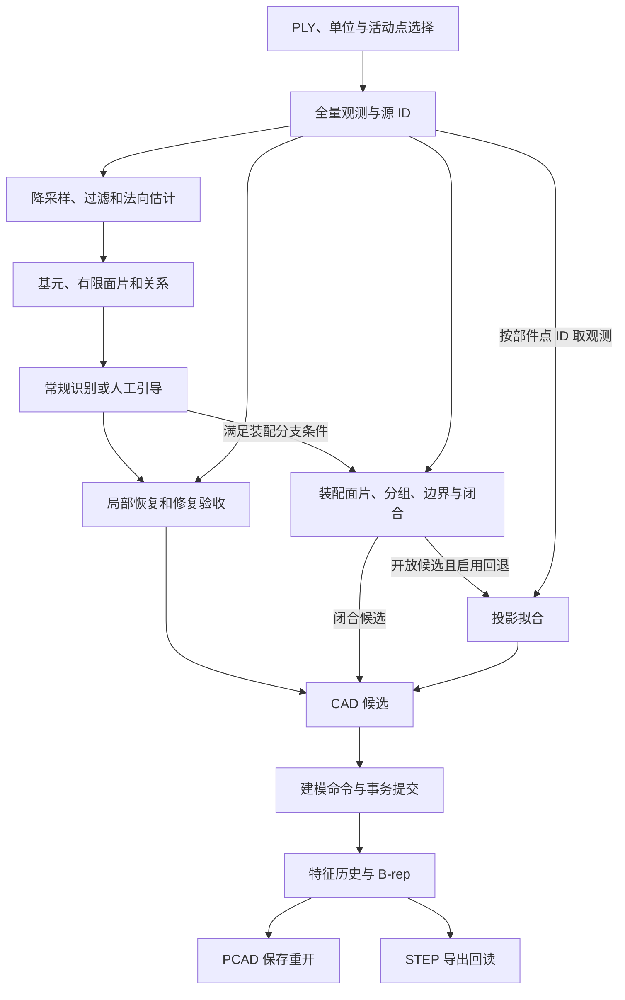

# 点云到 CAD 的模块契约与重构计划

本文覆盖从 PLY 或点云快照进入重建，到参数化 CAD、PCAD 保存重开和 STEP 导出的链路。按可独立验收的行为划分为 **34 个模块、6 组**。编号是计划中的验证边界。表中的源码位置指当前工作树，输入和输出列描述重构后的目标契约。34 个模块可以共享代码、数据夹具和组合入口。

相机采集和点云生成位于此范围之前。视口绘制、菜单交互和文本参数解析属于客户端适配层。活动点选择与源 ID 映射计入点云入口，异步任务和结果提交计入生产编排。

## 1. 当前流程和跨阶段数据

上图把任务编排中的主要数据边画出来。当前任务从同一份输入生成工作点云和只做尺度转换的全量恢复观测。无显式模板和关系时，常规识别失败或任务按当前规则判定为多体，才尝试装配分支。装配结束后，可选回退从开放部件的点 ID 取得单件观测，再执行投影拟合。单件验证命令可以直接进入投影分支。 [生产任务](<../apps/ParamCAD Studio/src/app/CadReconstructionTask.cpp#L41>) · [装配回退](../core/geometric_reconstruction/src/recognition/assembly/AssemblyReconstruction.cpp#L20) · [独立拟合命令](../tools/validation/native/cad_reconstruction_validation.cpp#L1007)

| 当前交界 | 实际耦合 | 拆分时的约束 |
| --- | --- | --- |
| 原始观测、工作点和局部恢复 | 全量点与降采样点并行存在。局部恢复从源点补充实际观测，常规识别还会核对重新合并后的快照。 | 保留同坐标系的原始观测和工作视图。局部恢复显式取得源快照、区域与搜索范围，并返回实际补入的点 ID。 |
| 解析证据、面片与关系 | `indexSurfaceEvidence` 目前同时生成面片和关系。`SurfaceAnalysisResult` 还携带修复快照及补充点。 | 允许组合快照继续存在。独立阶段使用可直接构造的证据集、面片集或关系图。区分基元方程、有限点片和拓扑边界。 |
| 装配分组、有限边界与闭合 | 装配用共享的 `WorkingData` 和可变的 `AssemblyReconstructionResult`。先基于工作样本分组并恢复边界，再回填全量观测。`closeParts` 还可能重写边界或尝试曲面实体。 | 记录工作样本归属和全量归属两种口径。保留观测轮廓与闭合阶段调整后的轮廓及来源，避免用后者替代前者参与边界评测。第一步提取接口时保留当前调用顺序。 |
| 投影拟合与实体试建 | `fitProjectionExtrusion` 同时管理证据、局部坐标、候选、OCCT 试建、分数和搜索。 | 按选轴、区间、轮廓、提案、评分、搜索分层。试建使用临时模型。评分固定接收指定的评分点视图。 |
| 识别候选与正式提交 | `commitCompoundCandidate` 翻译候选，分配临时 ID，检查替换策略并应用补丁。不同候选类型的操作依赖由翻译逻辑决定。 | 建模计划明确操作顺序、草图依赖和目标体。计划与应用分别验证，提交继续由修订检查和事务保护。 |

源码依据见 [分析快照](../core/geometric_reconstruction/include/reconstruction/analysis/SurfaceAnalysis.h#L73)、[面片索引](../core/geometric_reconstruction/src/analysis/SurfacePatches.cpp#L50)、[修复事务](../core/geometric_reconstruction/src/recognition/RepairTransaction.cpp#L33)、[装配内部工作数据](../core/geometric_reconstruction/src/recognition/assembly/AssemblyInternal.h#L9)、[装配回填顺序](../core/geometric_reconstruction/src/recognition/assembly/AssemblyReconstruction.cpp#L195)、[闭合时的轮廓调整](../core/geometric_reconstruction/src/recognition/assembly/PartClosure.cpp#L68)、[投影拟合](../core/geometric_reconstruction/src/recognition/ProjectionExtrusion.cpp#L536)和[候选提交](../core/geometric_reconstruction/src/modeling/ModelingAdapter.cpp#L5)。

## 2. 模块功能、目标输入输出与实际源码

优先级按**接口改造价值**划分。**P0** 表示优先定义边界并拆开耦合。**P1** 表示在基线建立后补薄接口或拆一个明确接缝。**P2** 表示现有入口可以承载主要验证，用适配器补齐样本和报告即可。

### A. 点云输入和预处理

| 编号与功能 | 目标输入 | 目标输出 | 当前实现 | 优先级 |
| --- | --- | --- | --- | --- |
| 01 点云读取、活动点快照与单位转换 | PLY 或内存点云、单位声明、可选活动点选择 | 统一单位的原始观测快照、坐标变换、稳定点 ID 与源行映射、导入诊断 | [PlyReader::read](<../apps/ParamCAD Studio/src/io/PlyReader.cpp#L539>)、[PointCloudAdapter](<../apps/ParamCAD Studio/src/io/PointCloudAdapter.cpp#L94>)、[活动点映射](<../apps/ParamCAD Studio/src/core/PointCloudEdits.cpp#L197>)。尺度转换也在 [preprocessPointCloud](../core/geometric_reconstruction/src/preprocessing/PointCloudPreprocessor.cpp#L35) 中执行。 | P0 |
| 02 降采样 | 观测视图、采样尺度、保护点 ID | 工作点视图、代表点及被保留的原始 ID、统计 | [voxelDownsample](../core/geometric_reconstruction/src/preprocessing/Downsampling.cpp#L30) | P2 |
| 03 离群过滤 | 工作点视图、过滤配置、保护点 ID | 保留和移除的点 ID、过滤统计 | [removeOutliers](../core/geometric_reconstruction/src/preprocessing/OutlierFilter.cpp#L4) | P2 |
| 04 法向、定向和曲率估计 | 工作点视图、已有法向及方向状态、邻域配置 | 与点 ID 对齐的法向、方向状态、可选曲率与退化诊断 | [estimateNormalsAndCurvature](../core/geometric_reconstruction/src/preprocessing/NormalEstimation.cpp#L4) | P2 |

### B. 曲面分析与修复

| 编号与功能 | 目标输入 | 目标输出 | 当前实现 | 优先级 |
| --- | --- | --- | --- | --- |
| 05 单次基元检测 | 工作点视图、启用类型、容差和随机种子 | 平面、圆柱、球、圆锥、圆环的参数、支持点、拟合误差和未覆盖点 | [detectPrimitiveEvidence](../core/geometric_reconstruction/src/detection/PrimitiveDetector.cpp#L7)、[CGAL 检测后端](../core/geometric_reconstruction/src/detection/cgal/CgalEfficientRansacDetector.cpp) | P2 |
| 06 多轮检测与证据汇集 | 工作点视图、检测入口、可选人工种子和多轮策略 | 合并后的证据、未覆盖点、轮数和分支诊断 | [detectMultiScalePrimitiveEvidence](../core/geometric_reconstruction/src/detection/MultiScaleDetector.cpp#L10)、[analyzeSurfaces 的分族和种子合并](../core/geometric_reconstruction/src/analysis/SurfaceAnalysis.cpp#L7) | P1 |
| 07 证据索引与有限面片拆分 | 基元证据、对应支持点、连通配置 | 面片、基元引用、支持点 ID、范围、方向和未归属点 | [indexSurfaceEvidence](../core/geometric_reconstruction/src/analysis/SurfacePatches.cpp#L50) 同时调用 08。 | P1 |
| 08 关系推断与人工约束校验 | 面片、局部观测、可选人工关系、容差 | 带误差、置信度及来源的关系图，接受和拒绝记录 | [inferSurfaceRelations](../core/geometric_reconstruction/src/analysis/SurfaceRelations.cpp#L32)、[applySurfaceRelationHints](../core/geometric_reconstruction/src/analysis/SurfaceRelations.cpp#L122) | P2 |
| 09 关系约束优化 | 几何快照、候选关系、观测证据及预算 | 修订后的几何、接受或拒绝的关系、前后误差 | [optimizeSurfaceRelations](../core/geometric_reconstruction/src/analysis/RelationOptimization.cpp#L32) | P2 |
| 10 局部观测恢复 | 工作视图、原始观测快照、失败区域、搜索范围 | 找回的源点 ID、局部面片和基元、余留失败原因 | [recoverLocalSurfaces](../core/geometric_reconstruction/src/analysis/LocalRecovery.cpp#L14) | P1 |
| 11 修复合并与复验 | 原分析快照、局部恢复提案、基线识别结果和复验策略 | 新快照及识别结果，或拒绝诊断。包含证据映射与前后变化。 | [recognizeAndRepairParametricSolid](../core/geometric_reconstruction/src/recognition/RepairTransaction.cpp#L33)、[分析快照物化](../core/geometric_reconstruction/src/analysis/AnalysisSnapshot.cpp) | P1 |

### C. 常规实体识别与人工引导

| 编号与功能 | 目标输入 | 目标输出 | 当前实现 | 优先级 |
| --- | --- | --- | --- | --- |
| 12 箱体识别 | 支持点和面证据、盒体配置 | 盒体姿态、尺寸、支持平面和质量 | [recognizeBoxFromAnalysis](../core/geometric_reconstruction/src/recognition/BoxRecognizer.cpp#L220)、[轴对齐盒体入口](../core/geometric_reconstruction/src/recognition/AxisAlignedBoxRecognizer.cpp#L24) | P2 |
| 13 贯穿孔识别 | 已知宿主、圆柱壁和开口证据、支持点 | 宿主引用、孔轴、半径、穿过的边界和壁厚 | [recognizeThroughHoles](../core/geometric_reconstruction/src/recognition/ThroughHoleRecognizer.cpp#L51)、[箱体与孔的组合入口](../core/geometric_reconstruction/src/recognition/ThroughHoleRecognizer.cpp#L198) | P2 |
| 14 独立曲面实体识别 | 部件观测、曲面证据和可用端面 | 球、圆柱、圆锥或圆环的有限参数、边界支持和拒绝原因 | [recognizeCurvedSolidFromAnalysis](../core/geometric_reconstruction/src/recognition/curved/CurvedSolidRecognizer.cpp#L42)、[曲面参数精修](../core/geometric_reconstruction/src/recognition/curved/CurvedFitting.cpp)、[端盖检测](../core/geometric_reconstruction/src/recognition/curved/CapDetection.cpp) | P2 |
| 15 组合体识别 | 定标点云、定向法向、可选边界与接口平面、预算 | 有界组合体提案、占据和边界误差、搜索状态 | [reconstructCompound](../core/geometric_reconstruction/src/recognition/compound/CompoundRecognizer.cpp#L5) 依次调用框架、材料单元、箱覆盖和边界验证。 | P2 |
| 16 混合特征识别 | 工作点云、分析快照、宿主及局部证据，可选恢复观测 | 基体、附着特征和切除候选、局部失败和修复提案 | [recognizeMixedFeatures](../core/geometric_reconstruction/src/recognition/mixed/MixedFeatureRecognizer.cpp#L6)、[宿主识别](../core/geometric_reconstruction/src/recognition/mixed/HostDetection.cpp)、[附着特征](../core/geometric_reconstruction/src/recognition/mixed/AttachedFeatures.cpp) | P1 |
| 17 模板和人工关系引导 | 点云、模板类型与选区 ID、关系，可选共享分析及源观测 | 各选区拟合、全局候选、更新后的分析和失败选区 | [reconstructGuidedSolid](../core/geometric_reconstruction/src/recognition/guided/GuidedSolidRecognizer.cpp#L9)、[模板拟合](../core/geometric_reconstruction/src/recognition/guided/HintFitting.cpp)、[验证模板](../core/geometric_reconstruction/src/recognition/guided/HintValidation.cpp) | P1 |

12–16 独立验证时指定识别器。`recognizeParametricSolidFromAnalysis` 的候选竞争和回退属于 34 的组合验证。14 的端盖与边界评估、15 的材料单元和覆盖选择、16 的宿主与附着特征可以继续加私有测试接缝。先复用现有实现与类型。 [当前常规识别编排](../core/geometric_reconstruction/src/recognition/ParametricSolidRecognizer.cpp#L30)

### D. 装配面片、分组、边界与闭合

| 编号与功能 | 目标输入 | 目标输出 | 当前实现 | 优先级 |
| --- | --- | --- | --- | --- |
| 18 装配面片提取 | 装配观测、工作样本和邻域配置 | 工作样本到面片的归属、面片姿态、平面性、局部间距和方向状态 | [reconstructAssembly 前段](../core/geometric_reconstruction/src/recognition/assembly/AssemblyReconstruction.cpp#L63)、[WorkingData](../core/geometric_reconstruction/src/recognition/assembly/AssemblyInternal.h#L9) | P0 |
| 19 面片连接、分组与全量归属 | 面片、局部邻接证据、需要回填的原始观测 | 面片连接图、部件组、工作点归属和全量点归属、未分配点 | [连接与分组](../core/geometric_reconstruction/src/recognition/assembly/AssemblyReconstruction.cpp#L175)、[全量回填](../core/geometric_reconstruction/src/recognition/assembly/AssemblyReconstruction.cpp#L196) | P0 |
| 20 有限边界恢复 | 面片支持点、局部坐标系、间距与容差、相邻面约束 | 外环、孔环或分离岛，含拓扑、吸附与回退诊断 | [recoverBoundaries](../core/geometric_reconstruction/src/recognition/assembly/FiniteBoundaries.cpp#L51)、[BoundaryGeometry](../core/geometric_reconstruction/src/recognition/assembly/BoundaryGeometry.cpp) | P0 |
| 21 共边与壳闭合 | 部件范围、面片与边界环、连接证据及必要的局部观测 | 壳状态、开边和非流形诊断，及通过验证的实体候选。若调整轮廓，输出带来源的修订。 | [closeParts](../core/geometric_reconstruction/src/recognition/assembly/PartClosure.cpp#L74)、[闭合时的凸边界重算](../core/geometric_reconstruction/src/recognition/assembly/PartClosure.cpp#L15) | P0 |

19 中的分组和回填适合是同一契约内的两次调用。当前 20 在这两次调用之间执行，取的是工作样本。21 可以基于完整观测判断闭合，也可调用局部解析曲面识别。测试夹具应明确是哪种点集和哪个版本的边界。 [当前装配返回类型](../core/geometric_reconstruction/include/reconstruction/recognition/AssemblyReconstruction.h#L57)

### E. 投影拉伸拟合

| 编号与功能 | 目标输入 | 目标输出 | 当前实现 | 优先级 |
| --- | --- | --- | --- | --- |
| 22 候选轴生成 | 部件观测、可选基元证据、方向策略和预算 | 候选方向、来源、支持信息和可选投影指标 | [基元、PCA 与侧壁选轴](../core/geometric_reconstruction/src/recognition/ProjectionExtrusion.cpp#L584)、[可选面积搜索](../core/geometric_reconstruction/src/recognition/ProjectionExtrusion.cpp#L628) | P0 |
| 23 拉伸区间与截面观测 | 部件观测、给定轴、尺度和容差 | 局部坐标系、端点或区间假设、各截面支持点和缺证据状态 | [capAt](../core/geometric_reconstruction/src/recognition/ProjectionExtrusion.cpp#L181)、[轴向范围计算](../core/geometric_reconstruction/src/recognition/ProjectionExtrusion.cpp#L652) | P0 |
| 24 二维截面恢复 | 给定坐标系、截面点、可选侧壁和孔壁证据 | 带外环、内环、曲线参数及证据的草图候选 | [profile](../core/geometric_reconstruction/src/recognition/ProjectionExtrusion.cpp#L212)、[共用的二维边界提取](../core/geometric_reconstruction/src/recognition/assembly/FiniteBoundaries.cpp#L19) | P0 |
| 25 基体、加材与切除提案 | 草图、轴向区间、孔槽或台阶证据、可选宿主 | 有草图平面、深度、方向、操作类型和目标引用的提案集 | [盲孔与槽](../core/geometric_reconstruction/src/recognition/ProjectionExtrusion.cpp#L406)、[基体与台阶提案](../core/geometric_reconstruction/src/recognition/ProjectionExtrusion.cpp#L671) | P1 |
| 26 候选实体评分 | 已试建的实体、固定评分点、容差、可选特征数量 | 距离与法向统计、缺少支持的面积、残差点 ID、总分及指标口径 | [evaluate](../core/geometric_reconstruction/src/recognition/ProjectionExtrusion.cpp#L312) | P0 |
| 27 操作序列搜索与选择 | 提案、试建和评分接口、搜索预算和接受策略 | 选中序列、质量、停止原因和搜索诊断 | [试建和评分包装](../core/geometric_reconstruction/src/recognition/ProjectionExtrusion.cpp#L389)、[搜索与验收](../core/geometric_reconstruction/src/recognition/ProjectionExtrusion.cpp#L719) | P1 |

先拆 22–24 与 26，可用真轴、已知端面和正误实体分别测试。25、27 的测试使用这些稳定边界。投影拟合可继续通过现有 `fitProjectionExtrusion` 对外调用，试建可继续走 `buildProjectionProgram` 和建模核心。 [投影公开契约](../core/geometric_reconstruction/include/reconstruction/recognition/ProjectionExtrusion.h#L49)

### F. CAD 构造、提交、持久化与生产编排

| 编号与功能 | 目标输入 | 目标输出 | 当前实现 | 优先级 |
| --- | --- | --- | --- | --- |
| 28 识别结果转建模计划 | 识别候选、当前特征快照、替换策略和预期修订 | 有序命令或 `ModelPatch`，显式草图依赖、目标体与拒绝原因 | [commitCompoundCandidate](../core/geometric_reconstruction/src/modeling/ModelingAdapter.cpp#L5) 同时负责计划和应用。投影另有 [buildProjectionProgram](../core/geometric_reconstruction/src/recognition/ProjectionExtrusion.cpp#L503)。 | P1 |
| 29 草图校验与构面 | 草图实体、解析后的草图平面和容差 | 可用面域，或开放、相交、退化及孔归属诊断 | [validateSketch](../core/parametric_modeling/src/SketchValidation.cpp#L9)、[buildSketchFace](../core/parametric_modeling/src/occt/SketchBuilder.cpp#L296) | P2 |
| 30 特征重建和 B-rep 运算 | 特征历史、参数、依赖、目标体及参考平面 | 重放后的 B-rep、各特征状态和语义面解析结果 | [RebuildEngine::rebuild](../core/parametric_modeling/src/RebuildEngine.cpp#L212)、[resolveSketchPlane](../core/parametric_modeling/src/SemanticFaces.cpp#L115)、[OCCT 构造器入口](../core/parametric_modeling/src/occt/Builders.h) | P2 |
| 31 编辑和原子提交 | 当前模型、命令或补丁、预期修订 | 新模型修订和变更项，或失败及回滚结果 | [ModelingCore::apply](../core/parametric_modeling/src/ModelingCore.cpp#L65)、[PartDocument](../core/parametric_modeling/src/PartDocument.cpp) | P2 |
| 32 PCAD 编解码与重开 | 工程快照或 PCAD 文件、格式版本 | 可重开的工程、复原的特征与引用、版本或校验诊断 | [FeatureCodec](<../apps/ParamCAD Studio/src/io/FeatureCodec.cpp#L313>)、[ProjectStore::save](<../apps/ParamCAD Studio/src/io/ProjectStore.cpp#L199>)、[ProjectStore::load](<../apps/ParamCAD Studio/src/io/ProjectStore.cpp#L284>) | P2 |
| 33 STEP 导出和回读验证 | 已验证的 B-rep、导出选项，或导出的 STEP | STEP 文件或回读的几何与转换诊断 | [核心 STEP 导出](../core/parametric_modeling/src/StepExporter.cpp#L39)、[客户端 STEP 载入](<../apps/ParamCAD Studio/src/io/StepModelLoader.cpp#L118>)、[验证工具的回读](../tools/validation/native/PointCloudCadValidation.cpp#L76) | P2 |
| 34 生产流程编排与结果交接 | 输入快照、配置、人工模板与关系、取消信号和工作区修订 | 采用的分支、完整或部分候选、阶段诊断、取消和结果交接状态 | [CadReconstructionTask](<../apps/ParamCAD Studio/src/app/CadReconstructionTask.cpp#L41>)、[常规候选分支](../core/geometric_reconstruction/src/recognition/ParametricSolidRecognizer.cpp#L30)、[工作区接收与提交](<../apps/ParamCAD Studio/src/app/PointCloudWorkspaceController.cpp#L567>) | P1 |

## 3. 固定接口与固定验证集

- **观测有来源，访问范围可见。** 以不可变的观测快照保存点 ID、单位、坐标变换和指纹。工作点、部件点、评分点通过限定范围的视图或 ID 列表表达。局部恢复、装配回填和其他确需全量观测的步骤显式声明所读的快照与范围。KD 树、数组下标和临时标签留在模块内部。
- **结果带快照和 ID 语义。** 区分源点 ID、基元 ID、面片 ID、部件 ID 和特征 ID。证据重建或合并后，提供可用的映射。单位、坐标系、方向可信状态和支持点范围随输出传递。
- **固定结果语义和失败类别。** 建议区分成功、部分结果、证据不足、输入非法、取消及运行失败。算法能自由选择候选、简化策略和内部数据结构。错误文本用于诊断，测试以结构化状态和指标为依据。
- **冻结验证契约。** 每个模块固定输入、上游夹具、独立真值、指标与容差。独立阶段可接收真轴、标准面片或正确实体作为合法夹具。生产链路测试只提供正常输入，真值由独立评分端读取。调整验收规则时单独升版本，并保留旧基线供比较。
- **用几何语义比较结果。** 轴向允许正反等价，闭环允许起点变化，对称件允许多个等价姿态。轮廓或实体匹配时以拓扑、位置、局部特征和几何误差验收。测试命令顺序、布尔目标和回滚时，再按相应语义约束比较特征历史。

推荐同一案例保留两种重放方式。以标准 U 形槽为例，独立轮廓测试提供固定截面坐标和面片支持点，验收开口、内外边及壁厚。整条拟合测试仅提供标准点云，检查最终实体与真值。对同一装配，把正确分组提供给边界及闭合测试，再用未分组点云验证分离。这样可以定位模块错误和交接错误。

## 4. 重构优先级与实施计划

| 优先处理 | 价值 | 建议改动及风险控制 |
| --- | --- | --- |
| **P0 · 01 的观测契约** | 多条分支同时读工作点和全量点，尺度或 ID 错误会扩散。 | 先统一快照标识、单位转换和源 ID 映射。对 mm/m 输入、保护点、删点后的映射和修复快照做等价验证。可由现有组合入口调用薄适配器。 |
| **P0 · 18–21 的装配交界** | 当前共用可变结果，难以单独判断误分组、坏轮廓和闭合错误。 | 保留调用顺序，先提取工作面片、分组和回填两种归属、观测边界及闭合结果。把闭合阶段的轮廓调整单独记录。复测近接、凹口、孔环和开放壳。 |
| **P0 · 22–24 和 26 的投影交界** | 这些阶段最需要替换，也已有明确的固定夹具和可量化验收指标。 | 在现有拟合入口内先提取私有可调用函数，沿用原阈值和候选顺序。用真轴测试端点，用真端面测试截面，用错形实体测试评分。接口稳定后再引入侧壁截面、面积搜索或圆弧拟合。 |
| **P1 · 06–07、10–11、16–17、25、27–28、34** | 主要问题是组合调度、输入过宽、诊断分散和试建与正式提交的界线。 | 提取需要独立验收的步骤，分开记录计划、搜索、复验与提交结果。识别分支的选择政策由组合测试保护。新旧入口并存期间用同一组案例核对语义。 |
| **P2 · 02–05、08–09、12–15、29–33** | 函数、构建器或事务入口已经能表达主要行为，收益更多来自数据和验收补齐。 | 优先直接调用现有入口，必要时加私有测试适配器。沿用 CGAL 检测、现有草图和 B-rep 构造、修订与回滚、PCAD 兼容和 STEP 转换。性能或几何重写由独立失败证据驱动。 |

### 阶段 0 · 冻结基线并准备夹具

记录工作树或构建标识、执行程序哈希、配置、种子和样本哈希。先选择一个解析 U 形槽、一个已知实例标签的双部件装配、一个带通孔或盲孔的实体及一个明确开放的壳。给这些样本保存标准观测和各阶段可重放夹具。用 `box-wall_019` 作为已有工件回归。人工审核的 226 个候选保留为项目样本，进入完整点云正例集前逐件检查对应特征的观测完整性。

现有工具已有逐面采样、装配探针、独立投影和纯点云重建命令，以及曲面和建模回归。先保存这些结果作为对照，复用评测与产物检查。 [验证命令入口](../tools/validation/native/cad_reconstruction_validation.cpp#L986) · [工具与现有指标](../tools/README.md#step-点云与逐面识别验证) · [曲面分析测试](../core/geometric_reconstruction/tests/analysis/surface_analysis_test.cpp) · [装配测试](../core/geometric_reconstruction/tests/assembly_reconstruction_test.cpp) · [建模烟测](../core/parametric_modeling/tests/modeling_core_smoke_test.cpp)

### 阶段 1 · 建立观测契约和装配边界

在当前生产入口之下规范 01 的快照，然后依次提取 18、19、20、21 的独立调用点。先用原有工作点和边界算法替换调用方式。装配用例逐项比较归属、环拓扑、开放状态和实体几何。通过后，错误报告应能区分面片漏提、分组错误、轮廓错误和闭合失败。

### 阶段 2 · 建立投影阶段接口

先提取 22、23、24、26，再让提案和搜索通过这些接口调用。给每步配一套可以绕开上游算法的夹具。检查 U 形槽的选轴、开口和壁厚，检查盲孔、直槽和台阶的操作提案，核对正确实体在评分中优于刻意错形的实体。整条拟合继续检查 PCAD 可编辑、STEP 回读和几何误差。

### 阶段 3 · 补齐其余验证并拆提交接缝

用现有入口补齐基元、常规识别、建模、持久化和导出的独立验证。按测试暴露的问题提取曲面分析、修复和人工引导的接缝。将 28 的命令翻译从 31 的应用事务中提取，保留正式提交的修订检查、目标体和回滚语义。用真实生产入口核对分支选择、取消和部分成功。验证程序复用统一案例清单和报告，每个阶段独立运行。

### 阶段 4 · 在冻结基线上比较算法替换

接口拆分与算法改进分别提交和验证。接口拆分比较点 ID、分组、拓扑、几何和失败语义是否等价。算法改进用同一版本的固定验证集比较几何精度、通过率、误接受率、失败阶段及耗时。证据充分的标准集和缺面、噪声、稀疏等变体分开报告。若几何或选择政策的改变属于预期改进，在报告中说明受影响的模块与案例，并保留此前基线。

第一批交付只需覆盖**观测快照、装配分组到闭合、投影选轴到实体评分**。这三处能建立可重放的验证样板。之后再扩展接口和案例，避免先改动已经有独立入口和稳定契约的识别器及建模内核。
